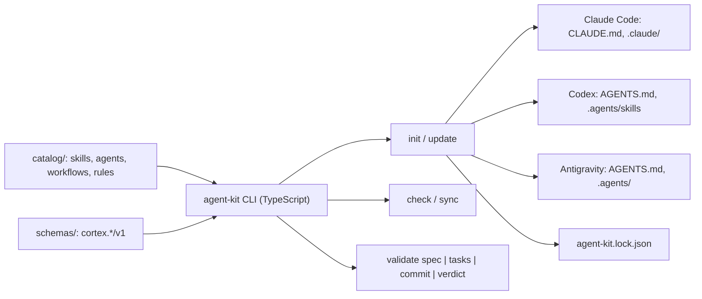

# Architecture — agent-kit

Target architecture. Each part is implemented through an approved spec (see `docs/sdd/README.md`).

## Overview



## Layout (planned)

```text
agent-kit/
├── catalog/
│   ├── agents/       # one Markdown file per role, with frontmatter
│   ├── skills/       # <name>/SKILL.md, references/, scripts/
│   ├── workflows/    # slash-command procedures
│   └── rules/        # always-on rules
├── schemas/          # JSON Schema 2020-12 for cortex.*/v1 envelopes
├── src/              # CLI: install, check, sync, validate
└── docs/
```

## Install model

- The shared brain is `AGENTS.md` plus `.agents/` in the target project.
- Codex and Antigravity read `AGENTS.md` and `.agents/skills/` natively; Antigravity also reads `.agents/rules/` and `.agents/workflows/`.
- Claude Code gets `CLAUDE.md` importing `@AGENTS.md`, plus generated `.claude/skills/`, `.claude/agents/` and `.claude/commands/` (links where the OS allows, copies otherwise).
- Project-specific additions go to `.agents/local/` and are never overwritten by `update`.
- `agent-kit.lock.json` records the kit version, the target CLIs and a hash per installed file, so `check` can detect manual edits and drift.

## Contracts

- Agent, skill, workflow and rule files use a versioned frontmatter format.
- `cortex.*/v1` schemas follow SemVer: incompatible changes require a major version.
- Names are checked against each CLI's built-in commands to prevent collisions.
