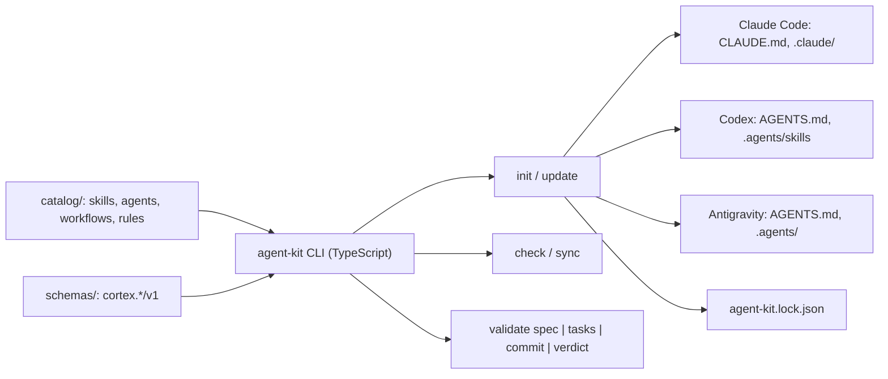

# Architecture — agent-kit

Target architecture. Each part is implemented through an approved spec (see `docs/sdd/README.md`).

## Overview



## Layout (planned)

```text
agent-kit/
├── .github/          # workflows/ci.yml (CI) and dependabot.yml
├── catalog/
│   ├── agents/       # one Markdown file per role, with frontmatter
│   ├── skills/       # <name>/SKILL.md, references/, scripts/
│   ├── workflows/    # slash-command procedures
│   └── rules/        # always-on rules
├── schemas/          # JSON Schema 2020-12: common.schema.json, frontmatter/*.schema.json (cortex.*/v1 envelopes planned)
├── src/              # CLI (TypeScript, ESM, zero runtime dependencies)
│   ├── cli.ts        # exports main(argv, io) returning the exit code; argument parsing, dispatch
│   ├── version.ts    # reads the package version at runtime
│   ├── schemas/      # contracts core
│   │   ├── validate.ts     # validator for the supported JSON Schema subset
│   │   ├── formats.ts      # date-time and uuid checks
│   │   ├── registry.ts     # loadRegistry(dir), validate(id, value), $id and path rules
│   │   └── frontmatter.ts  # frontmatter extraction and restricted YAML parser
│   └── commands/     # one module per command (check-self today; install, sync, validate later)
├── tests/            # Vitest unit tests; tests/smoke runs the built dist/
└── docs/
```

## Install model

- The shared brain is `AGENTS.md` plus `.agents/` in the target project.
- Codex and Antigravity read `AGENTS.md` and `.agents/skills/` natively; Antigravity also reads `.agents/rules/` and `.agents/workflows/`.
- Claude Code gets `CLAUDE.md` importing `@AGENTS.md`, plus generated `.claude/skills/`, `.claude/agents/` and `.claude/commands/` (links where the OS allows, copies otherwise).
- Project-specific additions go to `.agents/local/` and are never overwritten by `update`.
- `agent-kit.lock.json` records the kit version, the target CLIs and a hash per installed file, so `check` can detect manual edits and drift.

## Contracts

- Agent, skill, workflow and rule files use a versioned frontmatter format.
- Names are checked against each CLI's built-in commands to prevent collisions.

### Schema validator

The runtime has no dependencies (ADR-0001), so `src/schemas/validate.ts` implements a declared subset of JSON Schema 2020-12 (ADR-0002). `ajv` is a development-time oracle in tests only.

- **Supported keywords:** `$schema`, `$id`, `$ref`, `$defs`, `title`, `description`, `examples`, `default` (annotation only, never fills the instance), `type`, `const`, `enum`, `properties`, `patternProperties`, `additionalProperties`, `required`, `maxProperties`, `items`, `minItems`, `maxItems`, `uniqueItems`, `minLength`, `maxLength`, `pattern`, `format`, `minimum`, `maximum`, `oneOf`, `anyOf`. `$schema`, `$id` and `$defs` are allowed only at the root of a file.
- **Fail closed:** an unsupported keyword, a malformed keyword value, an unsupported `format`, a remote, unresolved or cyclic `$ref`, a nested `$id`/`$schema`/`$defs`, or a `pattern` without `maxLength` is a load error naming the file and the JSON Pointer. Nothing is silently ignored. `$ref` is local (`#/$defs/<name>`) or by `$id`, with an optional `#/$defs/<name>` fragment.
- **Safety:** lookups use own properties only, so `__proto__` or `constructor` are ordinary data. A `pattern` is not evaluated when `maxLength` already failed (ReDoS guard). Results hold at most 50 errors, and quoted values and property names are cut to 80 characters.
- **`format` is an assertion**, unlike the 2020-12 default (annotation). Only `date-time` (RFC 3339, with calendar and leap-second checks) and `uuid` (8-4-4-4-12 hex, any case) exist; non-string values pass.

### Schema identity and versions

`loadRegistry(dir)` loads every `*.schema.json` under `schemas/`. The `$id` must match the path: `frontmatter/agent.schema.json` is `urn:agent-kit:frontmatter:agent:v1`, and `<base>.v<N>.schema.json` (N >= 2) is `...:v<N>`. A file named `.v1` or `.v0` is invalid. `$schema` must be the 2020-12 URI. `agent-kit check --self` loads the schemas of the repository under check (`<root>/schemas`), never those of the installed package.

### Frontmatter

Files start with a `---` block (optional BOM) parsed by `src/schemas/frontmatter.ts`, a restricted YAML subset. Every accepted document means the same as in YAML 1.2; anything else is an error with a line number.

- Top-level `key: value` pairs only; no nested maps, anchors, aliases, tags, duplicate keys or tabs in indentation. The keys `__proto__`, `constructor` and `prototype` are rejected.
- Values: plain, single-quoted and double-quoted strings; lowercase `true`/`false`; safe integers; inline lists (`[a, b]`); block lists (`- item`); block scalars `|`, `|-`, `>`, `>-`.
- `null`, `~`, dates, floats and `True` stay strings. Ambiguous numbers (`+1`, `007`, `0x1F`, beyond 2^53-1) are errors: quote them.
- The block is limited to 16 KiB, checked before parsing. CRLF and LF give the same result. Parsed objects have a `null` prototype.

The four schemas under `schemas/frontmatter/` (`agent`, `skill`, `workflow`, `rule`) require `format: agent-kit/v1`, `name` and `description`, forbid unknown keys, and allow extension keys `x-<name>`. Shared definitions live in `schemas/common.schema.json` (`urn:agent-kit:common:v1`). No schema defines a `model` field or names a vendor or model; `tier` is an abstract effort level. `check --self` validates every catalog file against its schema, requires `name` to match the file or folder name, and keeps skills and workflows in one namespace. If the schemas fail to load, every catalog file fails (fail closed).

### Compatibility rule

`cortex.*/v1` schemas follow SemVer and the `$id` carries the major. A published schema is compatible when every instance valid under the published version stays valid under the new one.

- **Compatible (same major):** relaxing a limit, or adding an `enum` value.
- **Needs a new major in a new file (`...:v2`):** tightening a limit, removing an `enum` value, or adding a property. Schemas use `additionalProperties: false`, so older readers would reject instances that carry the new property.

An automatic guard for this rule is planned for spec-07.
